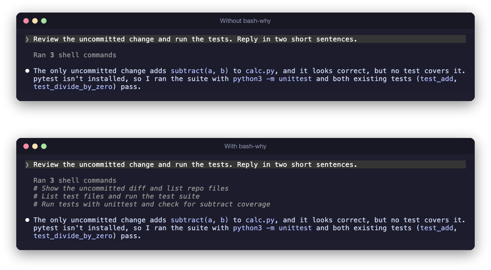

<div align="center">

# bash-why

**See why every shell command ran, long after it scrolled by.**

A small [Claude Code](https://claude.com/claude-code) plugin that writes the purpose of each Bash command right under it in the transcript.




</div>

## Install

```
/plugin install bash-why --marketplace wintermelyn/bash-why
```

Run it at the Claude Code prompt, answer `y`, and pick the user scope so it loads in every project.

## Use

It works on its own. `/bash-why off` hides the lines and `/bash-why on` brings them back.

Descriptions follow the language you write in, and folded groups like "Ran 3 shell commands" get one line per command.

## Codex (prototype)

```
codex plugin marketplace add wintermelyn/bash-why
codex plugin add bash-why@bash-why
```

Then approve its hooks in `/hooks`. The purpose shows above each command as a hook line, and `BASH_WHY=off` hides it. [How it differs](docs/codex.md).

---

[How it works, cost and development](docs/how-it-works.md) · [Codex prototype](docs/codex.md) · [MIT License](LICENSE)
